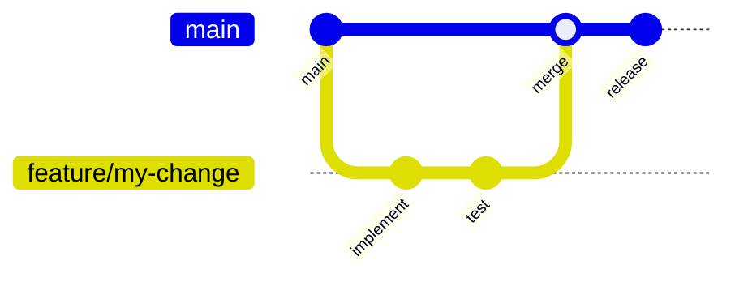
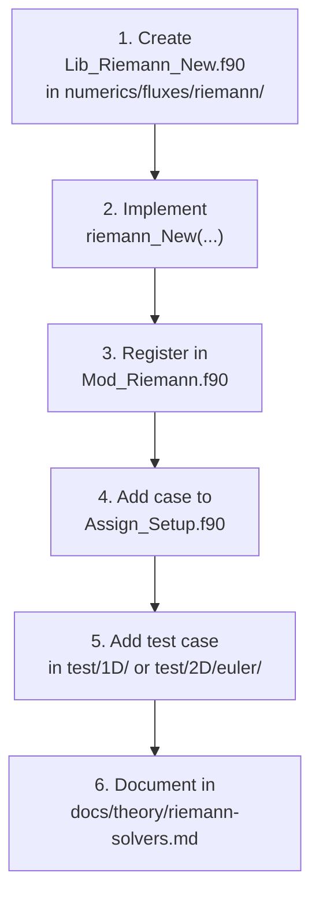
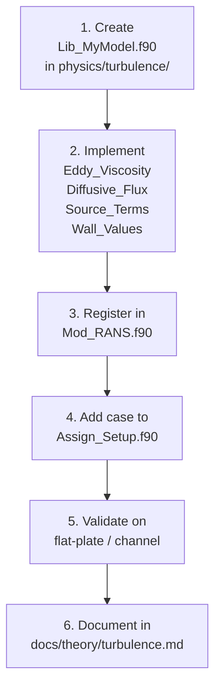
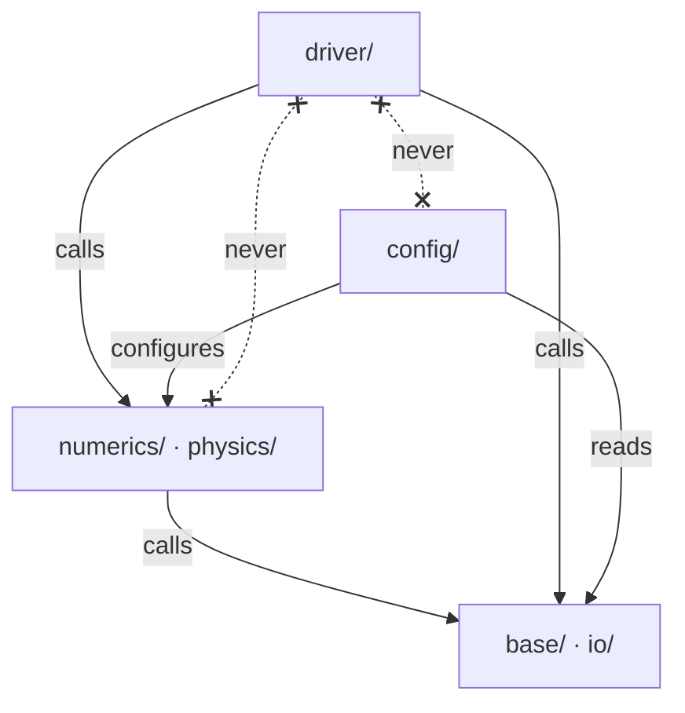

# Contributing

Thank you for your interest in contributing to Q2D.  This page
describes the development workflow, coding conventions, and review
process.  Q2D contributions are governed by the **five immutable
laws** that governed the structural development:

1. **Don't lose anything** — every Q2D legacy feature must be
   findable in Q2D per a file-by-file porting map.
2. **Don't hallucinate** — every claim about the code must be
   anchored to the file you are reading right now.
3. **Stay in scope** — work on the current phase only.
4. **Don't deceive** — failing tests, broken builds, and assumptions
   must be reported truthfully.
5. **One-to-one with MOSE** — Q2D mirrors the MOSE architectural
   template structurally.

---

## Development Workflow



1. **Fork or branch** — create a feature branch from `main`.
2. **Implement** — make your changes in small, focused commits.
3. **Test** — run the relevant test suite (see [Testing](testing.md)).
4. **Push** — push your branch and open a pull request.
5. **Review** — address feedback; maintainers will merge when ready.

---

## Setting Up a Development Environment

```bash
# 1. Clone with submodules
git clone --recurse-submodules https://github.com/open-hydra/Q2D.git
cd Q2D

# 2. Build in debug mode
./install.sh build --compilers=gnu

# 3. (Optional) Update submodules to latest
./install.sh update --remote

# 4. Iterative recompilation
./install.sh compile

# 5. Activate in-tree git hooks
git config core.hooksPath .githooks
```

!!! tip "CMakePresets.json"

    After the first `install.sh build`, a `CMakePresets.json` is
    generated with your compiler paths and library locations.
    Subsequent builds only need `./install.sh compile` (or
    `cmake --build build`).

---

## Coding Conventions

### Fortran Style

| Rule | Detail |
|------|--------|
| **Standard** | Fortran 2008 (`-std=f2008`) |
| **Line length** | Hard limit of **132 characters**; use `&` continuation |
| **Indentation** | 2 spaces; no tabs |
| **Module naming** | `Q2D_*_m` for public modules (mirror MOSE `MOSE_*_m`) |
| **File naming** | `Mod_*` for modules with state/dispatchers; `Lib_*` for utilities; `IO_*` for I/O; `Wrap_*` for high-level drivers |
| **Variable naming** | `snake_case` for locals; `obj_` prefix for global singletons |
| **Implicit typing** | Always use `implicit none` |
| **`use` clauses** | Always `use modulo, only: simbolo1, simbolo2` (never bare `use`) |
| **Intent** | Declare `intent(in)`, `intent(out)`, or `intent(inout)` for all arguments |
| **Precision** | Use `iso_fortran_env` kinds: `int32`, `real64` (alias `R8`) |

### File Organisation

- One module per file (exceptions: small helper modules).
- File name matches module name minus the `Q2D_` prefix.
- Computational routines go in `Lib_*.f90`; types and pointers in
  `Mod_*.f90`.

### Commit Messages

Use imperative mood, present tense, with a phase prefix when
applicable:

```
[Fase A] docs/theory — content porting body MOSE-derived

Body 1:1 mirror MOSE src/lib/generic_file.f90.
```

---

## Adding a New Riemann Solver

As a concrete example of extending Q2D:



1. Create `src/lib/numerics/fluxes/riemann/Lib_Riemann_New.f90` with
   a subroutine matching the `Riemann` procedure-pointer interface.
2. Implement the solver; the interface receives left/right primitive
   states, the face normal, and returns the numerical flux.  Note
   that Q2D Riemann solvers are written natively in 2D (drop
   `wl`/`wr`/`F_w`/`nz`).
3. In `Mod_Riemann.f90`, add the new solver name to the selection
   logic.
4. In `config/Assign_Setup.f90`, bind the procedure pointer
   `Riemann => riemann_New` for the new keyword.
5. Add a test case that exercises the solver on a known Riemann
   problem.
6. Document the solver's theory and properties.

---

## Adding a New Turbulence Model



The procedure-pointer interface in `Mod_RANS` requires four routines:

| Pointer | Signature purpose |
|---------|-------------------|
| `Eddy_Viscosity` | Compute $\mu_t$ from model variables |
| `RANS_Diffusive_Flux` | Turbulent diffusion (12-argument signature) |
| `RANS_Source_Terms` | Production / destruction source |
| `RANS_Set_Wall_Values` | Wall boundary conditions |

When binding `Stress_Vector` for the new model, choose either
`Stress_Vector_Std` (2D planar) or `Stress_Vector_Axi` (2D
axisymmetric / Q2D area-variation with optional Definition A
`V_dot_G`) — see [Turbulence Modelling](../theory/turbulence.md#general-rans-features).

---

## Layer Boundaries

Respect the separation between layers (mirror MOSE):



- **driver/** calls numerics/physics and io but never config.
- **numerics/** and **physics/** never call upward into driver.
- **config/** configures numerics/physics but does not call driver.
- **base/** is a leaf layer with no upward dependencies.

The Q2D-specific `numerics/sources/` directory sits inside
`numerics/` and is dispatched caller-side from `Mod_Explicit` through
the `obj_source%models(:)` polymorphic registry.

---

## Pull Request Checklist

Before submitting a PR, please verify:

- [ ] Code compiles with `-std=f2008 -Wall -Wextra` without warnings.
- [ ] No line exceeds 132 characters.
- [ ] All new subroutines have `implicit none` and argument intents.
- [ ] No `do k` indices, no `(:, :, 1)` slices, no `Nk` / `nz`
      references in the new code (the `.githooks/pre-commit` hook
      flags violations).
- [ ] Existing tests pass (`ctest --test-dir build --output-on-failure`).
- [ ] New functionality has at least one test case.
- [ ] Documentation updated if user-facing behaviour changed
      (`docs/`, in English — mirror MOSE).
- [ ] If the change touches BC, Riemann, or turbulence, document any
      non-trivial rename, split, or merge of a public routine.
- [ ] Commit messages follow the convention above.
