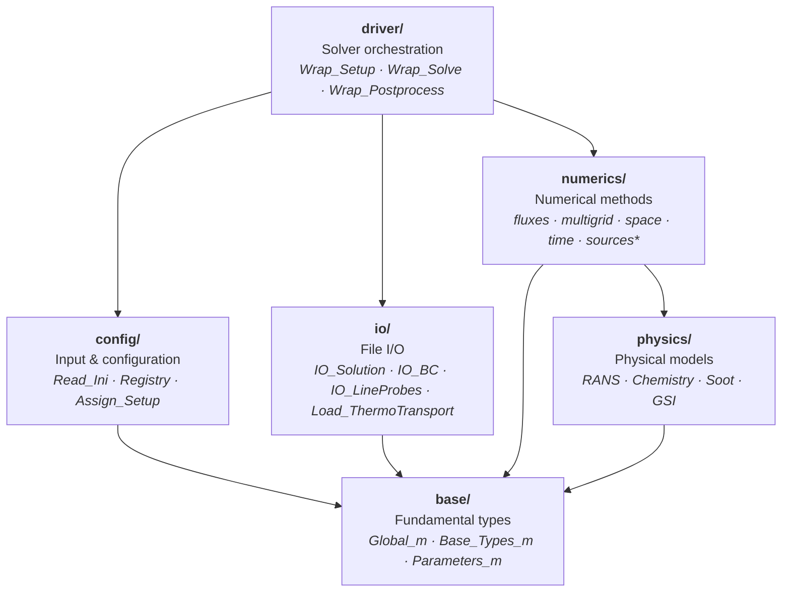
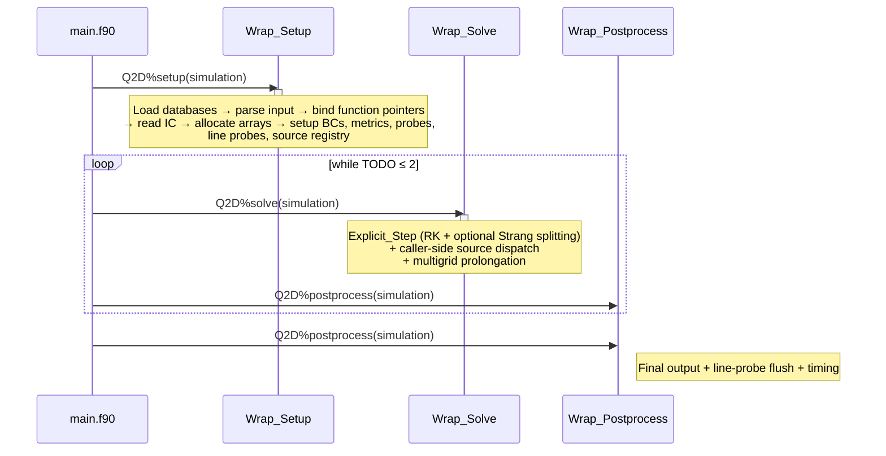

# Code Structure

This page documents the repository layout, the internal architecture
of the Q2D library, and the solver execution pipeline.  The layout
mirrors the MOSE structural template, with a few Q2D-specific
additions described in [Differences from MOSE](#differences-from-mose)
below.

---

## Repository Layout

```
Q2D/
├── CMakeLists.txt          # Top-level CMake build
├── CMakePresets.json        # Developer presets (compilers, paths)
├── install.sh               # Build / compile / update helper
├── mkdocs.yml               # Documentation site configuration
│
├── src/
│   ├── app/
│   │   └── main.f90         # Q2D solver entry point
│   └── lib/                 # Q2D library
│       ├── base/            # Q2D_*_m types, parameters, advanced types, series data
│       ├── config/          # Q2D_Config_Types_m, Registry, IO_Setup, Assign_Setup
│       ├── diagnostic/      # Mod_Diagnostic — public surface
│       ├── driver/          # Wrap_Setup, Wrap_Solve, Wrap_Postprocess, Procedures_m
│       ├── io/              # IO_Setup, IO_BC, IO_Solution, IO_Wall, IO_Probes,
│       │                    #   IO_LineProbes,
│       │                    #   Load_Chemistry, Load_ThermoTransport
│       ├── numerics/        # Numerical methods
│       │   ├── fluxes/      #   Mod_Fluxes (do/task dispatcher), Lib_Convective,
│       │   │   ├── bc/      #     16 BC handlers (MOSE-form one-to-one)
│       │   │   └── riemann/ #     11 selectable Riemann solvers (MOSE-form one-to-one)
│       │   ├── multigrid/   #   Mod_Multigrid, Lib_Multigrid
│       │   ├── space/       #   Limiters (incl. LIMO3), Reconstruction,
│       │   │                #     Metrics, Mod_Space, Lib_Ghost
│       │   ├── time/        #   Mod_dt, time/explicit/{Mod_Explicit, Lib_Newstate,
│       │   │                #     Lib_RK, Lib_IRS, Lib_Strang}
│       │   └── sources/     #   ★ Q2D-only: Source_Axisymmetry,
│       │                    #     Source_Areavariation, Mod_Sources, Register_Sources
│       ├── parallel/        # Mod_MPI, Mod_GhostExchange (4-face)
│       └── physics/         # Lib_Chemistry, Lib_GSI (incl. GSI_Paraffin),
│                            #   Lib_Soot, Lib_RotatingFrame
│           └── turbulence/  # Lib_Fluid, Mod_RANS, Lib_RANS, Lib_Spalart, Lib_SST,
│                            #   Lib_Wilcox2006, Lib_SSGLRR, Lib_QCR2000, Lib_SpalartShur
│
├── lib/                     # External dependencies (git submodules)
│   ├── FLINT/               # Thermochemistry library
│   ├── ORION/               # Structured-grid I/O library
│   └── third_party/
│       ├── FiNeR/           # INI file parser
│       └── ExactPack/       # Exact Riemann solver (Python, for V&V)
│
├── test/                    # Validation test suite
│   ├── 1D/                  # 1-D shock tube cases (Sod79, Tor99, Ein91, Noh87,
│   │                        #   ShuOsher-LIMO3)
│   ├── 2D/                  # 2-D steady and unsteady cases (euler/, viscous/)
│   └── common/              # Shared thermodynamic databases
│
├── docs/                    # MkDocs documentation source
├── tools/                   # Helper scripts (gen_coarse_bc.py,
│                            #   gen_riemann_exact.py, gen_noh_exact.py)
├── .githooks/               # pre-commit (No-w grep) + pre-push (ctest)
├── cmake/                   # CMake modules (flags, OpenMP, etc.)
├── bin/                     # Built executable Q2D
└── build/                   # Build artefacts
```

---

## Differences from MOSE

Q2D mirrors the MOSE structural template closely.  The Q2D-specific
additions are:

| Q2D addition | Description |
|---|---|
| `numerics/sources/` directory | Geometric source terms `Source_Axisymmetry` and `Source_Areavariation` for the axisymmetric and Q2D area-variation regimes. |
| `Lib_BC_Fluxes_Inflow_Nozzle.f90` `BC_Nozzle_Borda_Flow` branch | Glaister 1988 generalised Riemann invariant for choked-nozzle inflow (Fievisohn 2016/2017). |
| `io/IO_LineProbes.f90` | Line-sampling probes: 1D profiles along fixed-index lines. |
| `numerics/fluxes/Mod_Fluxes.f90` `Assign_Fluxes('do' \| 'task')` | OMP runtime-selectable loop dispatcher; the `do` variant is the default. |
| `diagnostic/Mod_Diagnostic.f90` extended public surface | Eight setup/diagnostic utilities (`Print_Header`, `Check_Tables`, `Check_Input`, `Check_IC`, `Check_BC`, `Print_Warnings`, `Stop_Simulation`, `Print_Shell_Info`) are exposed as public symbols of `Q2D_Mod_Diagnostic` for separation of concerns and testability. |

Two **strict reductions** apply across the entire codebase:

- **2D dimensional reduction (No-$w$ principle)** — no `do k`, no
  `(:, :, 1)` slices, no `Nk`/`nz` references.  The 4 faces of every
  block are i_min, i_max, j_min, j_max only.
- **`Stress_t(3,3)` storage preserved** — the stress tensor is 3×3
  even in 2D, to carry the Definition A out-of-plane component
  $S_{33} = -\mathbf{V}\!\cdot\!\mathbf{G}$ of the Q2D area-variation
  regime.  This is a required storage for that component, **not** a 3D
  leftover.

---

## Dependencies

**Required submodules** (always linked, located in `lib/`):

| Library | Purpose |
|---------|---------|
| `FLINT` | Thermochemistry (internally depends on `OSlo` ODE solvers) |
| `ORION` | Structured multi-block grid I/O |
| `FiNeR` | INI file parser |

Optional compile-time dependencies (Cantera, TecIO, SUNDIALS, MPI)
are enabled via CMake flags; see [Installation](../getting-started/installation.md).
`ExactPack` (Python) is used only for V&V post-processing and is
never linked at compile time.

---

## Library Architecture

The Q2D library is organised in six layers.  Lower layers have no
knowledge of higher layers.



The `*` next to `sources` marks the Q2D-only geometric source terms.

---

## Solver Pipeline

The main program (`src/app/main.f90`) creates a `Q2D_simulation_type`
object and calls three phases: **setup**, **solve** (in a loop), and
**postprocess**.



!!! info "Bootstrap-guard `input.ini` (CI/test smoke)"

    The `Read_Ini` setup step contains a bootstrap-guard: if
    `INPUT/input.ini` does not exist, `obj_sim_param%TODO = 3` is set
    immediately and the main `loop while TODO ≤ 2` is bypassed.  The
    binary `bin/Q2D` exits cleanly with banner stamp only — useful for
    CI/test smoke tests that verify the executable is well-formed
    without requiring a configured case directory.

### Explicit Step

Each call to `Explicit_Step` performs one complete time step:

1. **Compute Δt** — local and global time steps from CFL and von
   Neumann conditions (2D only).
2. **Strang splitting** (if `N_strang = 2`) — wrap the RK stages
   with two half-step chemistry integrations.
3. **Runge–Kutta loop** (repeated `n_RK` times per step):
    - Fill ghost cells (boundary and inter-block conditions; 4 faces
      only).
    - Evaluate convective fluxes (reconstruction → Riemann solver),
      via `Fluxes_omp_do` or `Fluxes_omp_task`.
    - Evaluate diffusive fluxes.
    - Apply boundary fluxes.
    - **Add geometric source terms** (Q2D-only): caller-side dispatch
      through `obj_source%models(:)` — axisymmetric `−1/r·(…)`,
      area-variation `∇h/h·(…)` with Definition A `V·G` coupling.
    - Add RANS source terms (if a turbulence model is active).
    - Add soot source terms (if the soot model is active).
    - Update conserved state via `RK_Newstate` (IRS smoothing + RK
      update).
4. **Compute residual** and write diagnostics.

---

## Convective Flux Evaluation

The convective flux at each cell interface is computed in five stages
from a 4-point stencil:

1. **Shock detection** — Jameson sensor flags cells near
   discontinuities (2D).
2. **MUSCL reconstruction** — extrapolation to the interface using
   one of 6 flux limiters (5 standard TVD limiters + LIMO3).
3. **Interface states** — left and right primitive-variable states
   at the face.
4. **Riemann solver** — one of 11 selectable solvers (see
   [Riemann Solvers](../theory/riemann-solvers.md)).
5. **Numerical flux** — result multiplied by the interface length
   vector (face length, not face area).

---

## RANS Turbulence Models

At run time the `[Q2D-Physics] turbulence` model string is parsed
and the selected implementation is bound to procedure pointers in
`Mod_RANS`: `Eddy_Viscosity`, `RANS_Diffusive_Flux`,
`Stress_Vector` (`_Std` or `_Axi`), `RANS_Set_Wall_Values`, and the
source/realizability hooks.

| Key | Implementation | Description |
|-----|---------------|-------------|
| `SA` | `Lib_Spalart` | Baseline Spalart–Allmaras |
| `SAcomp` | `Lib_Spalart` | + compressibility correction |
| `SA-R` | `Lib_Spalart` | + rotation correction |
| `SA-RC` | `Lib_SpalartShur` | Rotation–curvature (Shur) correction |
| `SST` | `Lib_SST` | Menter k-ω SST |
| `Wilcox2006` | `Lib_Wilcox2006` | Wilcox k-ω (2006 revision) |
| `SSGLRR` | `Lib_SSGLRR` | SSG/LRR-ω Reynolds-stress model (4 stresses + ω) |
| `SSGLRR-SD` | `Lib_SSGLRR` | SSG/LRR-ω with shock-detector diffusive flux |

Optional corrections are activated as **suffixes of the model
string**, not separate INI keys: `-QCR2000` (quadratic constitutive
relation, `Lib_QCR2000`; SA family only, e.g. `SA-QCR2000`) and
`-blowcorr` (wall-blowing correction, e.g. `SST-blowcorr`).

---

## Line probes

The `IO_LineProbes` module provides periodic sampling of the solution
along **fixed-index lines** (constant $i$ or constant $j$ in
computational coordinates).  Each line probe records the requested
variables at every cell along the line and writes to a dedicated
Tecplot file.

### Configuration

Line probes are declared as numbered `lineprobeN = <name>` entries,
each pointing to its own named section:

```ini
[Q2D-LineProbes]
lineprobe1 = bl_x10
lineprobe2 = radial_profile
restart    = false            ; true to append, false to overwrite

[bl_x10]
variables      = rho(1) u v p T M
diter          = 100          ; write every 100 iterations
index-position = 1 1          ; block 1, direction 1 (i fixed, sample along j)
fixed-index    = 50           ; wall-normal line at i = 50

[radial_profile]
variables      = rho(1) u v p T
diter          = 50
index-position = 2 2          ; block 2, direction 2 (j fixed, sample along i)
fixed-index    = 1
```

`index-position` takes the block index and the line direction
(`1` = $i$ fixed, sample along $j$; `2` = $j$ fixed, sample along
$i$); `fixed-index` is the constant index defining the line.  Both
are mandatory.  Each probe writes to `OUTPUT/<name>.tec` (one
Tecplot zone per output instant).  The section prefix
follows the codename bootstrap convention described in
[Input File](../user/input.md#section-namespacing).

### Typical applications

- Boundary-layer profiles in flat-plate / shock-wave / boundary-layer
  interaction simulations (wall-normal probes at a sequence of
  streamwise stations).
- Radial profiles in axisymmetric nozzle and detonation
  configurations (constant-$i$ probes intersecting the symmetry
  axis).

---

## ATLAS coupling

Q2D can be driven standalone from the command line **or** embedded
as a library inside the ATLAS top-level orchestrator that couples
multiple solvers in the open-hydra release.  Three boolean flags
in `Config_Types_m`, all defaulting to `.false.`, gate the
handover of control:

| Flag | Effect when `.true.` |
|---|---|
| `HYDRA_time_accurate` | The time step is supplied by ATLAS through `Set_Global_dt`; the local CFL / VNN computation is bypassed. |
| `HYDRA_postprocess` | The solution write schedule is driven by ATLAS; the standalone `nprint` cadence is ignored. |
| `HYDRA_MG` | The multigrid configuration is read from the `[HYDRA-Multigrid]` section instead of `[Q2D-Multigrid]`, allowing ATLAS to coordinate the multigrid hierarchy across solvers. |

In standalone runs all three flags remain `.false.` and Q2D
executes its own time loop, write schedule, and multigrid
registration.  When ATLAS sets them before invoking the Q2D entry
points (`Q2D_Setup`, `Q2D_Solve`, `Q2D_Postprocess`), the
corresponding internal logic is bypassed in favour of the
externally supplied control.

The flags are evaluated in `Mod_Explicit`, `Wrap_Postprocess`,
`Backend_INI`, and `Register_Numerics` respectively.  Standalone
Q2D regression coverage (every entry of the ctest battery) runs
with the defaults; coupled-mode validation is exercised at the
open-hydra release level.

---

## Data Structures

The top-level type `Q2D_simulation_type` holds an array of grid
levels (one per multigrid level) and an I/O container:

```
Q2D_simulation_type
├── domain(:)   Q2D_domain_type     — one entry per multigrid level
│   ├── blk(:)  Q2D_block_type      — one entry per structured block
│   │   ├── P(:,:,:)    real64       — primitive variables (rank 3, not 4)
│   │   ├── C(:,:,:)    real64       — conservative variables
│   │   ├── R(:,:,:)    real64       — residual (flux accumulator)
│   │   └── dtlocal(:,:) real64      — local time step
│   ├── nb      integer              — number of blocks
│   ├── iter    integer              — iteration counter
│   ├── time    real64               — physical time
│   └── dtglobal real64              — global time step
└── IOfield(:)  IOfield_type         — I/O metadata
```

| Array | Shape | Content |
|-------|-------|---------|
| `P` | `(nprim, ni, nj)` | Primitive variables (no $k$ index) |
| `C` | `(ncons, ni, nj)` | Conservative variables |
| `R` | `(ncons, ni, nj)` | Residual (flux accumulator) |
| `dtlocal` | `(ni, nj)` | Local time step per cell |

---

## Build System

### CMake targets

| Target | Type | Description |
|--------|------|-------------|
| `Q2D_lib` | Static library | Core solver + all physics/numerics; links FLINT, ORION, FiNeR |
| `Q2D` | Executable | Standalone solver (`src/app/main.f90`) |
| `DocGen` | Executable | Registry documentation generator (`src/app/docgen.f90`) — regenerates `docs/user/registry.md` from the compiled parameter registry |

### Dependency paths

Submodule paths are set via CMake cache variables (falling back to the
in-tree submodules; see the root `CMakeLists.txt`):

| Variable | Default | Library |
|----------|---------|---------|
| `ORION_PATH` | `lib/ORION/` | ORION multi-format I/O |
| `FLINT_PATH` | `lib/FLINT/` | FLINT thermochemistry (bundles OSLO ODE solvers under `lib/FLINT/lib/OSLO/`) |
| `FINER_PATH` | `lib/third_party/FiNeR/` | FiNeR INI parser |
| — | `lib/third_party/ExactPack/` | LANL ExactPack (analytic references for the offline `verify.py` studies; not linked into the solver) |

### Build workflow

```bash
# Option A: install.sh (recommended for first build)
./install.sh build --compilers=gnu

# Option B: CMake presets (for iterative development)
./install.sh compile          # uses CMakePresets.json
# or equivalently:
cmake --preset default && cmake --build build
```

### Key CMake options

| Option | Default | Library | Effect |
|--------|:-------:|---------|--------|
| `USE_OPENMP` | OFF | OpenMP | Enable shared-memory threading |
| `USE_MPI` | OFF | MPI | Enable distributed-memory parallelism |
| `USE_SUNDIALS` | OFF | SUNDIALS | Alternative ODE solvers for chemistry |
| `USE_CANTERA` | OFF | Cantera | Alternative chemistry backend |
| `USE_TECIO` | OFF | TecIO | Enable Tecplot binary output |

---

## Naming Conventions

| Convention | Example | Meaning |
|------------|---------|---------|
| `Q2D_` prefix | `Q2D_Global_m` | Public Fortran module |
| `obj_` prefix | `obj_sim_param` | Global configuration singleton |
| `Lib_` prefix | `Lib_SST` | Computational routine library |
| `Mod_` prefix | `Mod_Riemann` | Module with types + pointers |
| `Wrap_` prefix | `Wrap_Solve` | Driver-level wrapper |
| `_m` suffix | `Config_Types_m` | Fundamental type module |
| `_type` suffix | `Q2D_block_type` | Derived type |
| `_Std` / `_Axi` suffix | `Stress_Vector_Std` / `Stress_Vector_Axi` | Q2D regime-specific dispatch |
