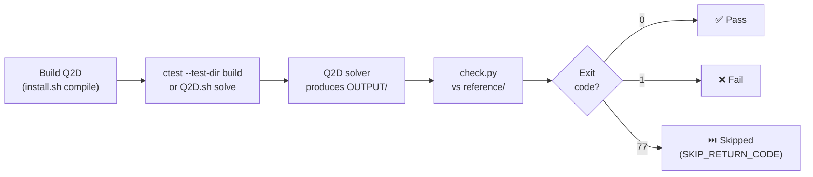

# Testing

Q2D ships with a validation test suite that exercises the solver on
canonical problems with known analytical or reference solutions.
This page describes the test organisation, how to run tests, and
how to add new cases.

---

## Test Organisation

```
test/
├── 1D/                        # 1-D shock tube validation cases
│   ├── Sod79/
│   ├── Tor99/
│   ├── Ein91/
│   ├── Noh87/
│   └── ShuOsher-LIMO3/        # Shu–Osher with the LIMO3 limiter
├── 2D/                        # 2-D validation cases
│   ├── euler/                 # Inviscid cases
│   │   ├── oblique-shock/
│   │   ├── prandtl-meyer/
│   │   ├── prandtl-meyer-lineprobe/  # Line-probe regression
│   │   ├── ramp-channel/
│   │   ├── hypersonic-cylinder/
│   │   ├── chang-nozzle/             # Axisymmetric
│   │   ├── chang-nozzle-mg2/         # Axisymmetric + 2-level multigrid
│   │   ├── planar-nozzle/            # Q2D area-variation
│   │   ├── planar-nozzle-mg2/        # Q2D area-variation + 2-level multigrid
│   │   ├── planar-nozzle-turbulent/  # Subdirs: kw/ rsm/
│   │   ├── borda-channel/            # Borda choked-inflow BC
│   │   ├── rocket-nozzle/            # Subdirs: frozen/ equilibrium/ finite-rate/
│   │   ├── SRM-rocket-motor/         # Axisymmetric
│   │   ├── rotating-channel/         # Rotating frame
│   │   ├── rotating-channel-rsm/     # Rotating frame + SSGLRR frame-invariance
│   │   ├── multi-solver-103/         # Per-face Riemann-solver selection
│   │   └── supersonic-forward-step/
│   └── viscous/               # Viscous cases
│       ├── flat-plate-laminar/
│       ├── flat-plate-turbulent/     # Subdirs: coarse-kw/ coarse-SA/ coarse-rsm/
│       │                             #          fine-SA/ fine-rsm/
│       ├── chang-nozzle-turbulent/   # Subdirs: kw/ rsm/
│       └── swbli/
└── common/                    # Shared thermodynamic databases
    ├── Air/                   # 5-species air (dimensional)
    └── nondim-Air/            # 5-species air (non-dimensional)
```

### Categories

| Category | Location | What is checked |
|----------|----------|-----------------|
| **1-D shock tubes** | `test/1D/` | Density, velocity, pressure profiles against exact solutions (ExactPack) |
| **2-D inviscid** | `test/2D/euler/` | Converged Euler flow fields against reference data |
| **2-D viscous** | `test/2D/viscous/` | Converged Navier–Stokes / RANS solutions against reference data |
| **Common** | `test/common/` | Shared thermodynamic databases used by multiple cases |

---

## Test Case Structure

Each test case is a self-contained directory:

```
test/1D/Sod79/
├── input.ini          # Solver input file
├── INPUT/             # Initial-condition files
├── MESH/              # Grid files
├── reference/         # Reference solution data
├── check.py           # CTest-driven regression (Q2D-uniform)
├── verify.py          # Standalone visualization + ExactPack (mirror MOSE)
└── Q2D.sh             # Run script
```

The key components are:

| File / Dir | Purpose |
|------------|---------|
| `input.ini` | Solver configuration (Riemann solver, CFL, output, ...) |
| `MESH/` | Pre-generated structured grid |
| `INPUT/` | Initial-condition field (ORION format) |
| `reference/` | Reference solution data |
| `check.py` | **CTest-driven regression** (uniform across the suite): reads `OUTPUT/field.tec` + `reference/exact.txt`, returns exit 0 (pass) or 1 (fail). Invoked by `ctest`. |
| `verify.py` | **Standalone visualization + verification** (mirror MOSE): uses ExactPack inline for the analytical reference, writes SVG plot, returns exit 0/1. Run manually with `python3 -B verify.py`. |
| `Q2D.sh` | Convenience script to compile, run, or kill the solver |

---

## Running Tests

### CTest integration

The whole suite is registered with CTest in
`test/CMakeLists.txt`.  Each test runs the solver in its own case
directory and then checks the result:

```bash
bash -c "./Q2D.sh solve && python3 -B check.py"
```

Run the suite from the build directory:

```bash
cd build
ctest --output-on-failure

# or without changing directory
ctest --test-dir build --output-on-failure

# run a subset by name or by label
ctest --test-dir build -R Sod79
ctest --test-dir build -L 1D
```

### Test tiers: `fast` and `heavy`

Every test carries a tier label that drives CI
(see the header of `test/CMakeLists.txt`):

| Tier | Label | Where it runs | Command |
|---|---|---|---|
| **fast** | `fast` | GitHub CI on every push/PR | `ctest -LE heavy` |
| **heavy** | `heavy` | locally / on many-core nodes | `ctest -L heavy` |

The heavy tier contains the RANS/viscous cases that need many
threads and/or hours of wall clock (`swbli`, `flat-plate-laminar`,
`flat-plate-turbulent-coarse-kw`, `ssglrr-chang-nozzle-turbulent`).
They are registered with `PROCESSORS 20`, run the solver via
`./Q2D.sh -p 20 solve`, and get `OMP_NUM_THREADS=20` from the CTest
environment; timeouts go up to 18000 s (`swbli`).  The local heavy
workflow is:

```bash
# on a node with >= 20 cores
ctest --test-dir build -L heavy --output-on-failure
```

Fast-tier tests run with `OMP_NUM_THREADS=1` and
`KMP_STACKSIZE=100M`; all tests additionally get
`PYTHONIOENCODING=utf-8` (check-script Unicode safety in `LC_ALL=C`
environments).

Two more properties are set suite-wide:

- **`SKIP_RETURN_CODE 77`**: a check script that cannot run its
  quantitative gate exits 77 and is reported by CTest as
  **Skipped** — never as a silent "Passed" (false green).  The only
  current legitimate skip is an under-converged `swbli` run
  (`SOLUTIONTIME < 95000`); missing solver outputs are always
  hard FAILs, since `Q2D.sh` wipes `OUTPUT/` before each solve.
- **`RESOURCE_LOCK <case directory>`**: tests sharing a case
  directory (e.g. `borda-channel` and its negative control
  `borda-channel-negctl`, which write the same `OUTPUT/`) are never
  run concurrently, so `ctest -j` stays safe.

### Single test case

2-D cases are run individually from their own directory:

```bash
cd test/2D/euler/oblique-shock

# Compile a local Q2D binary
./Q2D.sh compile

# Run the solver
./Q2D.sh solve

# Run with OpenMP (4 threads)
./Q2D.sh -p 4 solve

# Run in background
./Q2D.sh -b solve

# Verify against reference
python3 -B verify.py
```

---

## Test Workflow Diagram



---

## Pre-push hooks

Q2D includes in-tree git hooks (activated via
`git config core.hooksPath .githooks`) that protect the test
invariants:

- **`pre-commit`** runs grep-based invariant checks on the staged
  `src/lib/*.f90` sources: No-$w$ principle violations (`do k =`
  loops, `Normal(3)` declarations) and orphan `TODO` markers without
  a phase reference.  Any hit blocks the commit until resolved
  (bypass, if really needed, with `git commit --no-verify`).
- **`pre-push`** runs the CTest validation suite
  (`ctest --test-dir build --output-on-failure --timeout 300`)
  against the `build/` directory.  Any failing test aborts the push.
  If no configured build directory is found, the hook prints a
  warning and skips the tests instead of blocking the push.

---

## Regression tolerance

The numerical regression tolerance budget for `Q2D legacy` vs
Q2D outputs is:

- `RELEASE -O0`: `eps_rel < 1e-12` (bit-per-bit modulo IEEE-754
  rounding).
- `RELEASE -O3`: `eps_rel < 1e-9` (L2 global), with localised
  `1e-6` budget near shocks and limiter flips (compiler reordering
  of FMA / OMP reductions).

---

## Adding a New Test Case

### 1-D shock tube

1. Create a directory under `test/1D/` (e.g. `test/1D/MyCase/`).
2. Provide `input.ini`, `MESH/`, and `INPUT/` with the problem
   setup.
3. Run the solver to generate a reference solution.
4. Save the reference data in `reference/` and write a `verify.py`
   that:
    - Reads the solver output.
    - Reads the reference data.
    - Compares key quantities (density, velocity, pressure) within
      tolerance.
    - Calls `sys.exit(0)` on success, `sys.exit(1)` on failure.
5. Copy `Q2D.sh` from an existing case (it is generic).

### 2-D case

Same structure.  Place the directory under the appropriate folder in
`test/2D/euler/` or `test/2D/viscous/`.  Multi-chemistry cases (e.g.
`rocket-nozzle`) may use subdirectories for each chemistry level
(`frozen/`, `equilibrium/`, `finite-rate/`) with a shared `verify.py`
at the parent level.

---

## Common Thermodynamic Data

The `test/common/` directory contains shared species databases:

| Directory | Content |
|-----------|---------|
| `Air/` | 5-species air (N₂, O₂, NO, N, O) with dimensional transport |
| `nondim-Air/` | Same mixture in non-dimensional form |

Test cases symlink to these files rather than duplicating them.

---

## Reference Solution Generation

The 1-D reference solutions are computed using
[ExactPack](https://github.com/lanl/ExactPack) (LANL, included as a
Git submodule in `lib/third_party/ExactPack/`), which provides exact
Riemann-problem solvers for canonical test cases (Sod, Toro,
Einfeldt, Noh, etc.).

There are **two complementary paths** in Q2D — the CTest-driven
`check.py` (uniform across all cases) and the standalone
`verify.py` (mirror MOSE):

| Path | Script | When invoked | Reference source |
|---|---|---|---|
| **CTest-driven** | `check.py` | `ctest` (uniform across cases) | `reference/exact.txt` — pre-generated by `tools/gen_riemann_exact.py` (Toro 2009 §4.3.2) or `tools/gen_noh_exact.py` (Noh 1987), both textbook-anchored |
| **Standalone (mirror MOSE)** | `verify.py` | Manual `python3 -B verify.py` | `exactpack.solvers.*` inline (`IGEOS_Solver` for Riemann; `Noh` for Noh) |

The two reference paths are numerically equivalent within float64.
The split exists so that the CTest harness stays free of heavy
Python dependencies (`scipy`, `matplotlib`) while still offering the
MOSE-mirror plotting workflow when contributors want SVG output.

### Python dependencies for `verify.py`

`verify.py` is the mirror-MOSE standalone path. To run it you need a
Python environment with:

- `numpy`
- `scipy` (transitive dependency of ExactPack)
- `matplotlib` (SVG plotting)
- ORION Python bindings (`lib/ORION/src/python` is added to
  `sys.path` automatically by the script)

These are not required by the CTest path (`check.py` uses only
`numpy`).

---

## Q2D-specific test coverage

In addition to the MOSE-mirror test suite, Q2D maintains coverage for
its specific features:

| Feature | Coverage |
|---|---|
| No-$w$ (2D reduction) | All 4-face block tests; pre-commit grep audit |
| Geometric sources | Axisymmetric: `2D/euler/chang-nozzle(-mg2)/`, `2D/euler/rocket-nozzle/`, `2D/euler/SRM-rocket-motor/`, `2D/viscous/chang-nozzle-turbulent/` |
| Definition A V·G | Q2D area-variation cases: `2D/euler/planar-nozzle(-mg2)/`, `2D/euler/planar-nozzle-turbulent/` |
| Borda flow | `2D/euler/borda-channel/` with `BC_Mach == -20` sentinel on BC 420 |
| Line probes | `2D/euler/prandtl-meyer-lineprobe/` |
| Multigrid | `2D/euler/planar-nozzle-mg2/`, `2D/euler/chang-nozzle-mg2/` |
| SSG/LRR-omega RSM | `ssglrr-chang-nozzle-turbulent`, `ssglrr-planar-nozzle-turbulent` ctests (kw/rsm pairs) |
| LIMO3 | `1D/ShuOsher-LIMO3/` (`flux-limiter = LIMO3`) |
