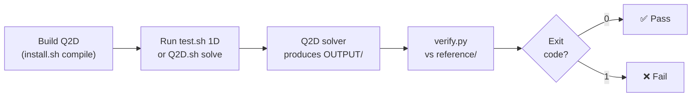

# Testing

Q2D ships with a validation test suite that exercises the solver on
canonical problems with known analytical or reference solutions.
This page describes the test organisation, how to run tests, and
how to add new cases.

---

## Test Organisation

```
test/
├── 1D/                        # 1-D shock tube validation cases
│   ├── Sod79/
│   ├── Tor99/
│   ├── Ein91/
│   └── Noh87/
├── 2D/                        # 2-D validation cases
│   ├── euler/                 # Inviscid cases
│   │   ├── oblique-shock/
│   │   ├── prandtl-meyer/
│   │   ├── ramp-channel/
│   │   ├── hypersonic-cylinder/
│   │   ├── chang-nozzle/
│   │   ├── rocket-nozzle/     # Subdirs: frozen/ equilibrium/ finite-rate/
│   │   └── supersonic-forward-step/
│   └── viscous/               # Viscous cases
│       ├── flat-plate-laminar/
│       ├── flat-plate-turbulent/
│       └── swbli/
└── common/                    # Shared thermodynamic databases
    ├── Air/                   # 5-species air (dimensional)
    └── nondim-Air/            # 5-species air (non-dimensional)
```

### Categories

| Category | Location | What is checked |
|----------|----------|-----------------|
| **1-D shock tubes** | `test/1D/` | Density, velocity, pressure profiles against exact solutions (ExactPack) |
| **2-D inviscid** | `test/2D/euler/` | Converged Euler flow fields against reference data |
| **2-D viscous** | `test/2D/viscous/` | Converged Navier–Stokes / RANS solutions against reference data |
| **Common** | `test/common/` | Shared thermodynamic databases used by multiple cases |

---

## Test Case Structure

Each test case is a self-contained directory:

```
test/1D/Sod79/
├── input.ini          # Solver input file
├── INPUT/             # Initial-condition files
├── MESH/              # Grid files
├── reference/         # Reference solution data
├── check.py           # CTest-driven regression (Q2D-uniform)
├── verify.py          # Standalone visualization + ExactPack (mirror MOSE)
└── Q2D.sh             # Run script
```

The key components are:

| File / Dir | Purpose |
|------------|---------|
| `input.ini` | Solver configuration (Riemann solver, CFL, output, ...) |
| `MESH/` | Pre-generated structured grid |
| `INPUT/` | Initial-condition field (ORION format) |
| `reference/` | Reference solution data |
| `check.py` | **CTest-driven regression** (uniform across 27 cases): reads `OUTPUT/field.tec` + `reference/exact.txt`, returns exit 0 (pass) or 1 (fail). Invoked by `ctest`. |
| `verify.py` | **Standalone visualization + verification** (mirror MOSE): uses ExactPack inline for the analytical reference, writes SVG plot, returns exit 0/1. Run manually with `python3 -B verify.py`. |
| `Q2D.sh` | Convenience script to compile, run, or kill the solver |

---

## Running Tests

### CTest integration

Q2D integrates with CTest from Phase 9 onwards:

```bash
cd build
ctest --output-on-failure
```

### 1-D test suite

The `test.sh` script automates the 1-D validation cases.  Run it
from the `test/` directory:

```bash
cd test

# Run all 1-D cases sequentially
./test.sh 1D

# Run all 1-D cases in parallel (splits idle cores across cases)
./test.sh -p 1D

# Clean all test output
./test.sh clean
```

### Single test case

2-D cases are run individually from their own directory:

```bash
cd test/2D/euler/oblique-shock

# Compile a local Q2D binary
./Q2D.sh compile

# Run the solver
./Q2D.sh solve

# Run with OpenMP (4 threads)
./Q2D.sh -p 4 solve

# Run in background
./Q2D.sh -b solve

# Verify against reference
python3 -B verify.py
```

---

## Test Workflow Diagram



---

## Pre-push hooks and audit scripts

Q2D includes in-tree git hooks (activated via
`git config core.hooksPath .githooks`) that protect the test
invariants:

- **`pre-commit`** runs the No-$w$ grep audit on staged sources
  (`grep -nE "do k|Normal\(3\)|wl,|wr,|F_w" src/`).  Any hit blocks
  the commit until resolved.
- **`pre-push`** runs the four sympy-based formal-audit scripts in
  `tools/audit/*.py` and the CTest validation suite.  All four
  scripts must exit 0 before the push is allowed:

| Script | Check |
|---|---|
| `cyl_ops_rans_audit.py` | Cylindrical-coordinate consistency of RANS sources (axisymmetric) |
| `implementation_topology_audit.py` | FV / metric-tensor consistency across regimes |
| `source_axi_lineby_line_audit.py` | Line-by-line axisymmetric residual derivation |
| `term_by_term_sympy.py` | Symbolic equivalence of area-variation terms (V·G) |

---

## Regression tolerance

The numerical regression tolerance budget for `Q2D legacy` vs
Q2D outputs is documented in the V&V section, see
[Regression Tolerance](../vv/regression_tolerance.md).  Acceptance
criteria:

- `RELEASE -O0`: `eps_rel < 1e-12` (bit-per-bit modulo IEEE-754
  rounding).
- `RELEASE -O3`: `eps_rel < 1e-9` (L2 global), with localised
  `1e-6` budget near shocks and limiter flips (compiler reordering
  of FMA / OMP reductions).

---

## Adding a New Test Case

### 1-D shock tube

1. Create a directory under `test/1D/` (e.g. `test/1D/MyCase/`).
2. Provide `input.ini`, `MESH/`, and `INPUT/` with the problem
   setup.
3. Run the solver to generate a reference solution.
4. Save the reference data in `reference/` and write a `verify.py`
   that:
    - Reads the solver output.
    - Reads the reference data.
    - Compares key quantities (density, velocity, pressure) within
      tolerance.
    - Calls `sys.exit(0)` on success, `sys.exit(1)` on failure.
5. Copy `Q2D.sh` from an existing case (it is generic).

### 2-D case

Same structure.  Place the directory under the appropriate folder in
`test/2D/euler/` or `test/2D/viscous/`.  Multi-chemistry cases (e.g.
`rocket-nozzle`) may use subdirectories for each chemistry level
(`frozen/`, `equilibrium/`, `finite-rate/`) with a shared `verify.py`
at the parent level.

---

## Common Thermodynamic Data

The `test/common/` directory contains shared species databases:

| Directory | Content |
|-----------|---------|
| `Air/` | 5-species air (N₂, O₂, NO, N, O) with dimensional transport |
| `nondim-Air/` | Same mixture in non-dimensional form |

Test cases symlink to these files rather than duplicating them.

---

## Reference Solution Generation

The 1-D reference solutions are computed using
[ExactPack](https://github.com/lanl/ExactPack) (LANL, included as a
Git submodule in `lib/third_party/ExactPack/`), which provides exact
Riemann-problem solvers for canonical test cases (Sod, Toro,
Einfeldt, Noh, etc.).

There are **two complementary paths** in Q2D — the CTest-driven
`check.py` (uniform across all 27 cases) and the standalone
`verify.py` (mirror MOSE):

| Path | Script | When invoked | Reference source |
|---|---|---|---|
| **CTest-driven** | `check.py` | `ctest` (uniform across cases) | `reference/exact.txt` — pre-generated by `tools/gen_riemann_exact.py` (Toro 2009 §4.3.2) or `tools/gen_noh_exact.py` (Noh 1987), both textbook-anchored |
| **Standalone (mirror MOSE)** | `verify.py` | Manual `python3 -B verify.py` | `exactpack.solvers.*` inline (`IGEOS_Solver` for Riemann; `Noh` for Noh) |

The two reference paths are numerically equivalent within float64.
The split exists so that the CTest harness stays free of heavy
Python dependencies (`scipy`, `matplotlib`) while still offering the
MOSE-mirror plotting workflow when contributors want SVG output.

### Python dependencies for `verify.py`

`verify.py` is the mirror-MOSE standalone path. To run it you need a
Python environment with:

- `numpy`
- `scipy` (transitive dependency of ExactPack)
- `matplotlib` (SVG plotting)
- ORION Python bindings (`lib/ORION/src/python` is added to
  `sys.path` automatically by the script)

These are not required by the CTest path (`check.py` uses only
`numpy`).

---

## Q2D-specific test coverage

In addition to the MOSE-mirror test suite, Q2D maintains coverage for
its specific features:

| Feature | Coverage |
|---|---|
| No-$w$ (2D reduction) | All 4-face block tests; pre-commit grep audit |
| Geometric sources | `2D/euler/rocket-nozzle/` (axisymmetric); 4 sympy audit scripts (cyl_ops, source_axi, term_by_term, topology) |
| Definition A V·G | `term_by_term_sympy.py` audit; q2D area-variation cases |
| Borda flow | `2D/euler/chang-nozzle/` with `BC_Mach == -20` sentinel |
| Line probes | Planned regression coverage |
| OMP do/task | `[Q2D-Numerics] omp_name = task` exercised on the largest 2D case |
| LIMO3 | `flux-limiter = LIMO3` setting on a smooth test case |
| `GSI_Paraffin` | BC 303 wall-melting case with non-zero `y_SEBS` |
