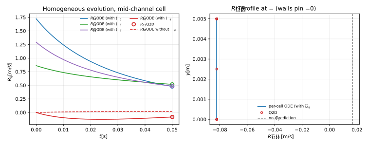

# Rotating Channel RSM — Frame-Invariance of the SSGLRR Closures

The RSM companion of the [rotating channel](2D-rotating-channel.md):
the same straight 2D plane channel with uniform axial throughflow in a
frame rotating about the out-of-plane axis, now carrying the
SSG/LRR-$\omega$ Reynolds-stress model with a spatially uniform,
anisotropic initial stress field. It is the **binary discriminant** for
the exact rotating-frame closures of [the rotating-frame theory
page](../theory/rotating-frame.md): the Coriolis production $G_{ij}$
and the absolute-vorticity $C_5$ pressure-strain.

**Feature exercised:** rigid-body **rotating frame + SSGLRR** coupling
(`Lib_SSGLRR.f90` $G_{ij}$ branch and $W^{\rm abs}$ shift) in the
2D-plane regime; time-accurate RK3; BC `201` periodic in $x$ +
BC `300` symmetry walls in $y$ (RSM odd-$R_{12}$ block of
`BC_Symmetry_Visc`); `RANS` band ghost/BC machinery end-to-end.

## Problem setup

Geometry, grid, frame ($\omega = 10$ rad/s, axis $[0,0,1]$) and mean
state ($u = U_\infty = 100$ m/s, $T_0 = 300$ K, $p_0 = 10^5$ Pa)
are the parent case's. The turbulence IC is uniform in the conserved
variables: $\rho R_{11} = 2.0$, $\rho R_{22} = 1.0$,
$\rho R_{33} = 1.5$, $\rho R_{12} = 0$ (compatible with the symmetry
walls, which pin $R_{12} = 0$), $\rho\omega_t = 400$ (SI), i.e.
$k/U_\infty^2 \approx 2\times10^{-4}$ — one-way coupled to the mean
flow. The run is **time-accurate** to $T = 0.05$ s
($\Omega T = 0.5$ rad).

## Expected behaviour

With $\nabla \boldsymbol{u}_{\rm rel} = 0$ the production vanishes,
$\omega_{\rm abs} = 2\Omega$, and every cell evolves by the
homogeneous ODE

$$\dot R_{ij} = G_{ij} + \Pi^{\rm slow}_{ij}(a)
  + \Pi^{C_5}_{ij}(a, W^{\rm abs}) - \tfrac23\varepsilon\,\delta_{ij},
  \qquad \dot\omega_t = -\beta_e \omega_t^2,$$

with the exact Coriolis production
$G_{11} = +4\Omega R_{12}$, $G_{22} = -4\Omega R_{12}$,
$G_{12} = 2\Omega(R_{22}-R_{11})$, $G_{33} = 0$
($\varepsilon$-branch constants: slip walls $\Rightarrow$ wall
distance $10^8$ $\Rightarrow F_1 = 0$). The discriminating signal is
$R_{12}(t)$, generated from zero purely by
$G_{12} = 2\Omega(R_{22}-R_{11})$. Frame-invariance provenance:
an ODE analysis proves this equation (with $G_{ij}$) is the
rotating-frame image of the inertial-frame model to RK4 order 4.0,
and that dropping $G_{ij}$ leaves an $O(1)$, $dt$-independent error.

Because $\rho(y)$ follows the geostrophic equilibrium
$\partial p/\partial y = -2\omega\rho U_\infty$, the uniform conserved
IC maps to per-cell primitive ICs: each cell tracks its **own** ODE
trajectory (gate G1).

## Numerical setup

| Parameter | Value |
|---|---|
| Time scheme | RK3, **time-accurate**, $T = 0.05$ s (4473 steps) |
| CFL | 0.5 |
| Turbulence | `SSGLRR` (5 eq: $\rho R_{11},\rho R_{22},\rho R_{33},\rho R_{12},\rho\omega_t$) |
| Space reconstruction | MUSCL / vanleer |
| Riemann solver | SLAU |

## Gates and results (`verify.py`, all hard)

| Gate | Criterion | Measured |
|---|---|---|
| G1 per-cell ODE tracking | $\max_j \|R^{\rm code}-R^{\rm ODE}(y)\|/k < 2\times10^{-2}$ | $1.33\times10^{-4}$ |
| G2 mid-channel vs full ODE | $\max\|R^{\rm code}-R^{\rm ODE}\|/k < 2\times10^{-2}$ | $1.32\times10^{-4}$ ($R_{12}$: $-0.0822$ vs $-0.0823$) |
| G3 discriminance | distance from the **no-$G_{ij}$** trajectory $\ge 5\times$ G2 | $1.38\times10^{-1}$ vs $1.32\times10^{-4}$ ($\sim10^3\times$) |

A binary without the exact Coriolis production lands on the no-$G_{ij}$
trajectory and **fails G2 by three orders of magnitude** — this case
turns the frame-invariance ODE proof into a solver-level regression
gate.

*Left: homogeneous ODE trajectories (solid, with $G_{ij}$) and the Q2D
mid-channel values at $t=T$ (circles); the dashed curve is the
$R_{12}$ trajectory without $G_{ij}$. Right: $R_{12}(T)$ profile
across the channel — Q2D vs the per-cell ODE; the symmetry walls pin
$R_{12}=0$ (disclosed diffusive layer), the grey dashed line is the
no-$G_{ij}$ prediction.*

## Known limitations

- The wall $R_{12}$ layer (odd parity at BC `300`) is excluded from G1
  (two wall rows); it is physical, not numerical.
- The case does not exercise the SA-RC/SST-RC $\tilde r$ frame term —
  a curved-flow binary gate for that path would require a dedicated
  annulus case (future work).
